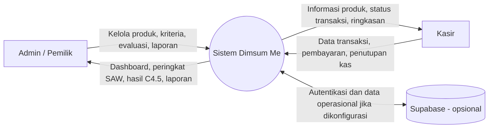
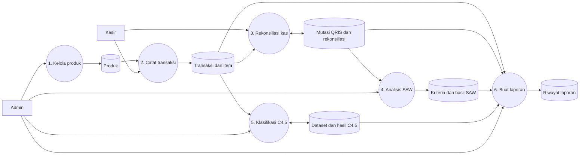
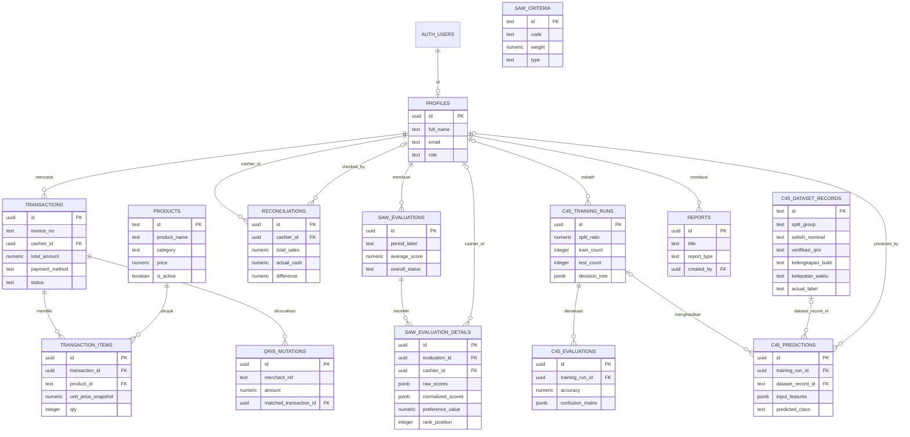

# LAPORAN PROYEK

## SISTEM INFORMASI PENJUALAN DAN EVALUASI KETEPATAN PENCATATAN PENERIMAAN KAS PADA UMKM DIMSUM ME MENGGUNAKAN METODE SAW DAN C4.5

**Disusun untuk memenuhi tugas mata kuliah [NAMA MATA KULIAH]**

**Disusun oleh:**

| No. | Nama | NIM |
|---|---|---|
| 1 | [Nama anggota 1] | [NIM] |
| 2 | [Nama anggota 2] | [NIM] |
| 3 | [Nama anggota 3] | [NIM] |

**[PROGRAM STUDI]**<br>
**[FAKULTAS]**<br>
**[NAMA PERGURUAN TINGGI]**<br>
**[TAHUN]**

> **Catatan akademik:** lengkapi identitas kelompok dan mata kuliah. Bagian kondisi mitra, hasil uji pengguna, serta tautan video hanya boleh diisi dengan bukti yang benar-benar dimiliki kelompok. Aplikasi publik saat ini adalah demo berbasis data simulasi dan tidak terhubung ke database Supabase aktif.

## Abstrak

Proyek ini mengembangkan prototipe sistem informasi berbasis web untuk mendemonstrasikan pencatatan penjualan, penerimaan pembayaran, verifikasi QRIS, rekonsiliasi kas, penyusunan laporan, serta evaluasi menggunakan metode Simple Additive Weighting (SAW) dan algoritma C4.5. Aplikasi dibangun dengan React, TypeScript, dan Vite. Rancangan backend menggunakan PostgreSQL melalui Supabase, termasuk autentikasi dan kebijakan Row Level Security (RLS), sedangkan versi publik GitHub Pages sengaja dijalankan sebagai demo tanpa login dan tanpa koneksi ke Supabase. Pengujian algoritma menggunakan data simulasi: lima alternatif dan lima kriteria SAW dengan total bobot 100%, serta 40 baris dataset C4.5 yang dibagi menjadi 28 data latih dan 12 data uji. Pada pembagian simulasi tersebut, C4.5 memperoleh akurasi 100%; nilai ini tidak dapat digeneralisasi ke transaksi nyata. Pemeriksaan implementasi meliputi pemeriksaan tipe TypeScript, delapan pengujian terarah, build produksi, serta keberhasilan workflow build dan deployment GitHub Pages. Koneksi ke database Supabase aktif, kesesuaian dengan data mitra, dan penerimaan pengguna belum diverifikasi. Dengan demikian, hasil proyek menunjukkan berjalannya prototipe dan alur algoritma pada data contoh, bukan bukti efektivitas operasional di UMKM.

**Kata kunci:** sistem informasi penjualan, penerimaan kas, rekonsiliasi, SAW, C4.5, Supabase.

---

# 1. Latar Belakang

Usaha mikro, kecil, dan menengah (UMKM) membutuhkan pencatatan transaksi yang tertib agar penjualan, penerimaan kas, pembayaran non-tunai, dan hasil penutupan kas dapat ditelusuri. Pencatatan yang terstruktur dapat membantu pengguna membandingkan nilai penjualan dengan penerimaan, memeriksa pembayaran QRIS, dan meninjau kelengkapan bukti transaksi. Kebutuhan tersebut menjadi dasar perancangan prototipe Dimsum Me; uraian ini merupakan konteks perancangan, bukan temuan lapangan yang telah dikonfirmasi.

Proyek ini mengembangkan sistem informasi untuk skenario operasional Dimsum Me. Sistem mencakup katalog produk, pencatatan transaksi, penerimaan kas, verifikasi pembayaran QRIS, rekonsiliasi kas, dan laporan. Sistem juga menyediakan dua fungsi analisis: metode **Simple Additive Weighting (SAW)** untuk menyusun peringkat evaluasi alternatif kasir/shift, serta algoritma **C4.5** untuk mengklasifikasikan ketepatan pencatatan penerimaan kas.

**Kondisi mitra.** Kondisi operasional mitra belum dibuktikan melalui data yang tersedia pada repositori. Lengkapi bagian berikut hanya setelah melakukan observasi atau wawancara langsung:

- Nama dan jenis usaha mitra: **[isi nama dan deskripsi singkat mitra]**
- Lokasi dan tanggal pemantauan: **[isi lokasi dan tanggal]**
- Narasumber/jabatan: **[isi dengan izin narasumber]**
- Proses pencatatan yang sedang digunakan: **[uraikan berdasarkan fakta]**
- Kendala yang ditemukan: **[uraikan temuan; sertakan contoh yang tidak mengungkap data pribadi]**
- Dampak kendala terhadap operasional: **[uraikan berdasarkan keterangan/hasil pengamatan]**

Data pada aplikasi saat ini berisi data contoh/simulasi yang disiapkan untuk menunjukkan alur kerja sistem. Data tersebut bukan bukti transaksi aktual dari mitra. Data simulasi digunakan agar sistem dapat didemonstrasikan tanpa mengungkap informasi transaksi nyata.

## 1.1 Rumusan Masalah

1. Bagaimana merancang aplikasi yang membantu pencatatan penjualan dan penerimaan kas pada skenario operasional Dimsum Me?
2. Bagaimana menerapkan SAW untuk menghitung nilai preferensi dan peringkat evaluasi kasir/shift?
3. Bagaimana menerapkan C4.5 untuk mengklasifikasikan pencatatan penerimaan kas ke dalam kategori **Sesuai**, **Perlu Pemeriksaan**, atau **Tidak Sesuai**?

## 1.2 Tujuan

1. Mengembangkan prototipe sistem penjualan dan evaluasi kas berbasis web.
2. Mengimplementasikan perhitungan SAW untuk perangkingan alternatif berdasarkan kriteria dan bobot.
3. Mengimplementasikan klasifikasi C4.5 dan menampilkan alur keputusan serta metrik evaluasinya.
4. Menyediakan simulasi penggunaan sistem yang dapat dievaluasi lebih lanjut bersama mitra.

## 1.3 Batasan

- Nilai transaksi, data evaluasi, dan dataset C4.5 bawaan merupakan data simulasi; perlu diganti atau divalidasi sebelum dipakai sebagai kesimpulan faktual tentang mitra.
- Hasil SAW bergantung pada kriteria, bobot, alternatif, dan nilai yang dimasukkan.
- Hasil C4.5 bergantung pada kualitas, jumlah, dan pembagian data latih/uji.
- Sistem merupakan alat bantu pencatatan dan evaluasi, bukan pengganti pemeriksaan keuangan atau keputusan pemilik usaha.
- Situs GitHub Pages yang dipublikasikan menggunakan `VITE_DEMO_MODE=true`, tidak menampilkan proses login, dan tidak mengirimkan data ke Supabase. Interaksi demo disimpan di penyimpanan lokal browser.
- Mode Supabase tersedia untuk konfigurasi pengembangan/produksi tersendiri, tetapi koneksi ke proyek Supabase aktif tidak diverifikasi dalam laporan ini.
- Data agregat simulasi pada dashboard tidak seluruhnya tersedia sebagai transaksi rinci; perbedaan tersebut dijelaskan pada Bagian 3.2.

## 1.4 Manfaat

1. **Bagi pengelola usaha:** menyediakan prototipe untuk melihat alur pencatatan transaksi, penerimaan, dan rekonsiliasi.
2. **Bagi kasir:** memperagakan pencatatan transaksi dan pemeriksaan status pembayaran dalam satu antarmuka.
3. **Bagi pengembang/peneliti:** menyediakan contoh penerapan SAW dan C4.5 pada skenario evaluasi pencatatan kas.
4. **Bagi pembelajaran:** menjadi bahan demonstrasi integrasi antarmuka web, basis data relasional, autentikasi, dan analisis data.

## 1.5 Metode Pengembangan dan Pengujian

Pengembangan prototipe dibagi menjadi empat tahap: (1) identifikasi kebutuhan fungsional yang tercermin pada modul aplikasi; (2) perancangan alur proses dan struktur data; (3) implementasi antarmuka, logika SAW/C4.5, serta opsi integrasi Supabase; dan (4) verifikasi melalui pemeriksaan tipe, pengujian terarah, build, dan deployment. Tahapan ini menjelaskan proses teknis yang dapat ditelusuri dari kode. Tahapan tersebut tidak menggantikan observasi kebutuhan pengguna atau uji penerimaan mitra.

Pengujian yang dapat dibuktikan dari repositori dan workflow dibatasi pada validasi teknis. Uji usability, uji penerimaan pengguna, uji beban, dan pengujian koneksi ke database Supabase aktif belum dilakukan atau belum memiliki bukti yang dapat dicantumkan.

# 2. Analisis dan Perancangan Sistem

## 2.1 Gambaran Umum

Sistem dibuat sebagai aplikasi web menggunakan React, TypeScript, dan Vite (Microsoft, n.d.; React, n.d.; Vite, n.d.). Antarmuka menyediakan menu dashboard, transaksi, produk, penerimaan kas, rekonsiliasi, analisis SAW, klasifikasi C4.5, laporan, pengaturan, dan profil. Rancangan aplikasi mengenal peran admin dan kasir; menu analisis SAW dan C4.5 dibatasi untuk admin pada antarmuka.

Terdapat dua konfigurasi yang perlu dibedakan. **Demo publik** di GitHub Pages menggunakan data simulasi sisi aplikasi dan penyimpanan lokal browser; demo ini tidak meminta login dan tidak tersambung ke Supabase. **Mode Supabase** dapat digunakan jika URL proyek dan anon/publishable key dikonfigurasi, tabel dibuat, akun Auth disiapkan, dan kebijakan RLS diterapkan. Keberadaan konfigurasi SQL tidak dengan sendirinya membuktikan bahwa database aktif telah dibuat atau terhubung.

Skema dan seed tersedia dalam `supabase/setup.sql`, sedangkan prosedur penautan profil demo ke pengguna Auth tersedia dalam `supabase/demo-users.sql`. Versi sumber SQL juga ditampilkan dari pengaturan aplikasi melalui blueprint TypeScript.

## 2.2 Context Diagram



**Penjelasan:** Admin mengelola produk dan melakukan evaluasi, sedangkan kasir mencatat transaksi dan data operasional. Sistem memberikan ringkasan dan hasil analisis sesuai peran pada mode yang mendukung autentikasi. Pada demo publik, halaman dibuka tanpa login menggunakan data simulasi di browser; Supabase bukan sumber data demo tersebut.

## 2.3 DFD Level 1



**Penjelasan proses:**

1. Admin memelihara data katalog produk.
2. Kasir memilih produk dan mencatat transaksi beserta metode pembayaran. Sistem menyimpan item transaksi dan nilai transaksi.
3. Data pembayaran dan penutupan shift dibandingkan pada proses rekonsiliasi.
4. SAW mengolah nilai alternatif per kriteria untuk menghasilkan nilai preferensi dan peringkat.
5. C4.5 membangun pohon keputusan dari data latih, kemudian mengklasifikasikan data uji atau masukan baru.
6. Ringkasan transaksi dan hasil analisis dapat ditampilkan dalam bagian laporan.

## 2.4 ERD Konseptual

Audit terhadap blueprint aplikasi dan `supabase/setup.sql` menemukan **14 tabel beserta relasi foreign key**. Daftar berikut menjelaskan rancangan skema pada berkas tersebut, bukan hasil inspeksi katalog database Supabase aktif:

| Tabel | Kolom sesuai DDL |
|---|---|
| `profiles` | `id` (PK, FK → `auth.users.id`), `full_name`, `email`, `role`, `shift`, `avatar_label`, `active`, `created_at`, `updated_at` |
| `products` | `id` (PK), `product_name`, `category`, `price`, `description`, `image_url`, `variant_options`, `max_variant_select`, `is_active`, `created_at`, `updated_at` |
| `transactions` | `id` (PK), `invoice_no`, `trx_date`, `trx_time`, `cashier_id` (FK → `profiles.id`), `cashier_name`, `total_amount`, `payment_method`, `cash_tendered`, `qris_ref`, `verification_status`, `status`, `notes`, `created_at` |
| `transaction_items` | `id` (PK), `transaction_id` (FK → `transactions.id`), `product_id` (FK → `products.id`, nullable), `product_name_snapshot`, `unit_price_snapshot`, `qty`, `image_url`, `selected_variants` |
| `qris_mutations` | `id` (PK), `merchant_ref`, `mut_date`, `mut_time`, `amount`, `issuer`, `settled`, `matched_transaction_id` (FK → `transactions.id`, nullable), `matched_invoice_no`, `created_at` |
| `reconciliations` | `id` (PK), `rec_date`, `shift`, `cashier_id` (FK → `profiles.id`), `cashier_name`, `total_sales`, `recorded_cash`, `recorded_qris`, `actual_cash`, `verified_qris`, `difference`, `status`, `admin_note`, `checked_by` (FK → `profiles.id`, nullable), `checked_by_name`, `updated_at` |
| `saw_criteria` | `id` (PK), `code`, `name`, `weight`, `type`, `description`, `updated_at` |
| `saw_evaluations` | `id` (PK), `period_label`, `average_score`, `overall_status`, `criteria_snapshot`, `created_by` (FK → `profiles.id`, nullable), `created_at` |
| `saw_evaluation_details` | `id` (PK), `evaluation_id` (FK → `saw_evaluations.id`), `alternative_id`, `alternative_label`, `cashier_id` (FK → `profiles.id`, nullable), `cashier_name`, `period`, `raw_scores`, `normalized_scores`, `preference_value`, `rank_position`, `category` |
| `c45_dataset_records` | `id` (PK), `split_group`, `selisih_nominal`, `verifikasi_qris`, `kelengkapan_bukti`, `ketepatan_waktu`, `actual_label`, `created_at` |
| `c45_training_runs` | `id` (PK), `split_ratio`, `train_count`, `test_count`, `root_attribute`, `root_entropy`, `root_gain_ratio`, `root_metrics`, `decision_tree`, `trained_by` (FK → `profiles.id`, nullable), `created_at` |
| `c45_evaluations` | `id` (PK), `training_run_id` (FK → `c45_training_runs.id`), `accuracy`, `macro_precision`, `macro_recall`, `macro_f1`, `confusion_matrix`, `per_class_metrics`, `created_at` |
| `c45_predictions` | `id` (PK), `training_run_id` (FK → `c45_training_runs.id`, nullable), `dataset_record_id` (FK → `c45_dataset_records.id`, nullable), `input_features`, `predicted_class`, `actual_class`, `is_correct`, `decision_path`, `predicted_by` (FK → `profiles.id`, nullable), `created_at` |
| `reports` | `id` (PK), `title`, `report_type`, `report_date`, `created_by` (FK → `profiles.id`), `created_by_name`, `created_at` |



**Penjelasan relasi:** `profiles.id` mereferensikan `auth.users.id`. Satu transaksi memiliki item-item transaksi; item dapat mereferensikan produk, dan tetap menyimpan snapshot nama/harga. Mutasi QRIS dapat dikaitkan ke transaksi. Rekonsiliasi memiliki `cashier_id` dan `checked_by`, keduanya mereferensikan profil. Detail SAW terhubung ke evaluasi dan secara opsional ke profil kasir. C4.5 menghubungkan evaluasi/prediksi ke training run; prediksi dapat terhubung ke baris dataset dan profil pengguna.

**Batas validasi:** pemeriksaan dilakukan terhadap definisi DDL dalam berkas project. Pemeriksaan ini memvalidasi rancangan skema dan relasinya, tetapi tidak membuktikan bahwa skema aktif di Supabase persis sama. Untuk menyatakan “sudah divalidasi terhadap database Supabase aktual”, bandingkan hasil query `information_schema.columns` dan foreign key dari database aktif dengan daftar di atas.

## 2.5 Pengendalian Akses dan Keamanan Data

Pada mode Supabase, kebijakan RLS membatasi data berdasarkan identitas Auth dan peran profil. Rancangan kebijakan pada `supabase/setup.sql` mencakup pembacaan profil sendiri atau admin; pembacaan produk aktif dan perubahan katalog oleh admin; akses kasir terhadap transaksi miliknya; akses item transaksi melalui transaksi induk; pengelolaan mutasi QRIS dan rekonsiliasi oleh admin; serta pembatasan data analisis dan laporan menurut peran/pembuat. RLS merupakan lapisan pembatasan akses di PostgreSQL dan harus diuji pada database aktif, bukan hanya diperiksa dari teks SQL (Supabase, n.d.).

Kebijakan tersebut tidak melindungi data pada demo GitHub Pages karena versi demo tidak mengakses Supabase. Data demo disimpan di browser pengguna dan tidak memiliki jaminan sinkronisasi atau kontrol akses server. Oleh karena itu, demo tidak boleh digunakan untuk memasukkan data pribadi atau keuangan nyata.

## 2.6 Rancangan Metode SAW

Alternatif awal pada aplikasi adalah evaluasi kasir/shift. Lima kriteria yang digunakan:

| Kode | Kriteria | Bobot | Jenis |
|---|---|---:|---|
| C1 | Kesesuaian nominal | 30% | Benefit |
| C2 | Kelengkapan pencatatan | 20% | Benefit |
| C3 | Verifikasi QRIS | 20% | Benefit |
| C4 | Kesesuaian kas fisik | 20% | Benefit |
| C5 | Kelengkapan bukti transaksi | 10% | Benefit |
| **Total** |  | **100%** |  |

Normalisasi benefit:

`r_ij = x_ij / max(x_j)`

Normalisasi cost:

`r_ij = min(x_j) / x_ij`

Nilai preferensi:

`V_i = Σ(w_j × r_ij)`

Bobot pada rumus dipakai sebagai proporsi (contoh bobot 30% menjadi 0,30). Alternatif diurutkan dari nilai `V_i` tertinggi. Implementasi memberi kategori **Baik** untuk skor ≥ 0,75, **Cukup** untuk skor ≥ 0,60 dan < 0,75, serta **Perlu Evaluasi** untuk skor < 0,60. Penggunaan SAW memerlukan bobot dan skor yang dapat dijelaskan; definisi, sumber, serta cara mengukur setiap nilai kriteria harus disepakati dengan mitra/pengajar (Triantaphyllou, 2000).

## 2.7 Rancangan Algoritma C4.5

Dataset C4.5 awal terdiri dari 40 baris simulasi: 28 data latih (`SIM-01`–`SIM-28`) dan 12 data uji (`TST-01`–`TST-12`). Atribut masukan:

1. Selisih nominal: Nol, Kecil (≤ Rp10.000), atau Besar (> Rp10.000).
2. Verifikasi QRIS: Terverifikasi, Menunggu, atau Tidak Cocok.
3. Kelengkapan bukti: Lengkap, Kurang, atau Tidak Ada.
4. Ketepatan waktu setor: Tepat Waktu atau Terlambat.

Label klasifikasi: **Sesuai**, **Perlu Pemeriksaan**, dan **Tidak Sesuai**. Implementasi menghitung entropy, information gain, split information, dan gain ratio. Secara ringkas:

`Entropy(S) = -Σ p_i log₂(p_i)`

`Gain(S,A) = Entropy(S) - Σ_v (|S_v| / |S|) × Entropy(S_v)`

`SplitInfo(S,A) = -Σ_v p_v log₂(p_v)` dan `GainRatio(S,A) = Gain(S,A) / SplitInfo(S,A)`.

Atribut dengan gain ratio tertinggi dipilih untuk pemisahan pohon. Pemisahan berhenti pada node murni, ketika atribut habis, atau ketika information gain tidak lagi melewati ambang implementasi. Pohon digunakan untuk memprediksi label; sistem menghitung confusion matrix, akurasi, macro-precision, macro-recall, dan macro-F1. Istilah C4.5 mengacu pada keluarga algoritma pohon keputusan yang diperkenalkan Quinlan (1993); hasil implementasi proyek tetap harus dievaluasi terhadap data representatif.

# 3. Implementasi dan Hasil Pengujian

## 3.1 Implementasi Aplikasi

Project menyediakan fitur-fitur berikut:

| Modul | Fungsi utama |
|---|---|
| Dashboard | Menampilkan ringkasan penjualan, transaksi, metode pembayaran, dan indikator operasional |
| Produk | Menampilkan katalog; admin dapat mengelola data produk |
| Transaksi | Mencatat item, jumlah, harga, metode pembayaran, dan referensi QRIS |
| Penerimaan kas | Menampilkan transaksi tunai dan QRIS serta status verifikasi pembayaran |
| Rekonsiliasi | Membandingkan penjualan, pencatatan tunai/QRIS, dan penerimaan aktual; hasil dapat ditinjau admin |
| Analisis SAW | Menampilkan bobot, normalisasi, nilai preferensi, kategori, dan peringkat alternatif |
| Klasifikasi C4.5 | Menampilkan atribut, pohon keputusan, prediksi, confusion matrix, dan metrik evaluasi |
| Pusat laporan | Menyediakan tujuh jenis laporan dengan pratinjau serta ekspor PDF, CSV, dan cetak |
| Pengaturan dan profil | Menyediakan pengelolaan aplikasi; tab pengaturan juga menampilkan blueprint SQL dan prosedur akun Auth |

### 3.1.1 Perbedaan Demo Publik dan Mode Supabase

| Aspek | Demo GitHub Pages | Mode Supabase |
|---|---|---|
| Akses | Langsung terbuka tanpa login; demo memulai sesi sebagai admin simulasi | Memerlukan konfigurasi URL/key dan sesi Auth |
| Sumber data | Data simulasi pada aplikasi; perubahan demo disimpan di browser pengguna | Tabel PostgreSQL Supabase dengan akses yang dikendalikan RLS |
| Status pada proyek | Aktif pada `https://graciayy.github.io/dimsum-me/` | Disediakan dalam source code, tetapi koneksi ke proyek Supabase aktif belum dibuktikan |
| Penggunaan yang tepat | Demonstrasi fitur dan alur aplikasi | Pengujian/penggunaan data backend setelah skema, Auth, RLS, dan environment dikonfigurasi |

Versi GitHub Pages secara eksplisit dibangun dengan `VITE_DEMO_MODE=true`; karena itu keberhasilan deployment situs tidak dapat ditafsirkan sebagai bukti koneksi Supabase.

## 3.2 Konsistensi Sumber Data dan Laporan

Sumber data harus dibedakan agar angka simulasi tidak dianggap sebagai transaksi aktual atau sebagai isi database aktif:

| Sumber | Isi yang dapat diverifikasi | Catatan |
|---|---|---|
| `src/data/seedData.ts` | Katalog dan data demo aplikasi, termasuk 12 transaksi rinci, 5 alternatif SAW, serta dataset C4.5 | Data simulasi di sisi aplikasi; bukan data transaksi mitra |
| `supabase/setup.sql` | 14 tabel, RLS untuk seluruh tabel, seed 25 produk, 5 kriteria SAW, dan 40 baris dataset C4.5 (28 latih, 12 uji) | Seed tidak mengisi transaksi/rekonsiliasi. Script tidak membuktikan pernah dijalankan pada project Supabase aktif. Upsert produk dan kriteria mengembalikan nilai seed saat dijalankan ulang |
| `supabase/demo-users.sql` | Upsert profil untuk empat akun Auth yang ditentukan | Akun harus dibuat lebih dahulu di Supabase Auth; script ini bukan akun demo GitHub Pages |
| `reports` pada skema | Metadata jenis laporan, tanggal, pembuat, dan judul | Skema menyimpan metadata laporan, bukan file PDF/CSV yang dihasilkan |

Pada demo lokal, dashboard tanggal 23 September 2026 menyertakan batch agregat simulasi sebanyak 98 transaksi, senilai Rp2.384.000 (QRIS Rp1.562.000 dan tunai Rp822.000), di samping 12 transaksi rinci senilai Rp386.000. Dengan demikian dashboard menunjukkan 110 transaksi dan total Rp2.770.000 untuk tanggal tersebut (QRIS Rp1.820.000; tunai Rp950.000). Namun, pratinjau **Laporan Penjualan** saat ini dibangun dari daftar transaksi rinci saja; pratinjau tersebut menampilkan 12 transaksi dan Rp386.000, tidak mencakup batch agregat 98 transaksi. Angka ini merupakan ketidaksesuaian cakupan data antara dashboard dan laporan rinci, bukan selisih kas yang telah diverifikasi.

Karena batch agregat tidak memiliki invoice, rincian item, kasir, atau status individual, data tersebut tidak boleh dipecah menjadi transaksi fiktif. Sebelum laporan penjualan dipakai sebagai laporan total harian, aplikasi perlu menampilkan batch secara eksplisit sebagai agregat atau menggunakan data transaksi rinci yang sama untuk dashboard dan laporan. Laporan akademik ini menyatakan perbedaan tersebut secara terbuka dan tidak menyamakan laporan rinci dengan total dashboard.

Dalam mode Supabase, dataset C4.5 dan kriteria SAW dapat disediakan melalui seed SQL. Akan tetapi, skema saat ini belum mempunyai tabel sumber alternatif SAW operasional; halaman SAW juga memberi peringatan bahwa alternatif demo bukan data operasional. Oleh sebab itu, peringkat lima alternatif yang dilaporkan berikut hanya berlaku untuk data simulasi frontend.

## 3.3 Hasil Demonstrasi SAW

Dengan lima alternatif dan data simulasi bawaan, hasil yang dihitung aplikasi adalah:

| Peringkat | Alternatif | Nilai preferensi | Kategori |
|---:|---|---:|---|
| 1 | Gracia — Shift Pagi (23 Sep) | 1,000 | Baik |
| 2 | Ferginia — Shift Siang (22 Sep) | 0,907 | Baik |
| 3 | Julio — Shift Sore (21 Sep) | 0,858 | Baik |
| 4 | Julio — Shift Sore (23 Sep) | 0,814 | Baik |
| 5 | Gracia — Shift Pagi (22 Sep) | 0,731 | Cukup |

Peringkat tersebut hanya hasil dari angka simulasi dalam aplikasi. Angka ini tidak boleh ditafsirkan sebagai penilaian kinerja aktual karyawan mitra.

## 3.4 Hasil Demonstrasi C4.5

Pada pembagian bawaan 28 data latih dan 12 data uji, akar pohon keputusan yang terbentuk adalah atribut **Verifikasi QRIS**. Evaluasi pada 12 baris uji simulasi menghasilkan:

| Metrik | Hasil |
|---|---:|
| Akurasi | 100% |
| Macro precision | 100% |
| Macro recall | 100% |
| Macro F1-score | 100% |

Confusion matrix data uji:

| Aktual \ Prediksi | Sesuai | Perlu Pemeriksaan | Tidak Sesuai |
|---|---:|---:|---:|
| Sesuai | 4 | 0 | 0 |
| Perlu Pemeriksaan | 0 | 4 | 0 |
| Tidak Sesuai | 0 | 0 | 4 |

Nilai 100% tersebut berlaku hanya pada dataset simulasi dan pembagian data yang tersedia. Dataset disusun sebagai contoh dengan pola label tertentu dan berukuran kecil; hasil ini belum membuktikan kemampuan prediksi pada transaksi nyata atau data baru. Pengujian lanjutan perlu menggunakan data mitra yang telah dianonimkan, label yang divalidasi, jumlah data memadai, dan evaluasi yang lebih kuat (misalnya validasi silang).

## 3.5 Pengujian dan Status Verifikasi

| Pengujian | Hasil | Batas interpretasi |
|---|---|---|
| Pemeriksaan tipe TypeScript (`tsc --noEmit`) | Lulus | Memeriksa tipe statis; bukan pengujian seluruh interaksi UI |
| Pengujian terarah `calculations.test.ts` | 8 dari 8 lulus | Meliputi perhitungan dan pemeriksaan struktur yang ditargetkan; bukan uji database aktif |
| Build produksi Vite | Lulus pada lingkungan pengembangan | Build dengan mode demo; peringatan ukuran chunk tidak menghalangi hasil |
| GitHub Actions, commit `b2df9fb` | Job `build` dan `deploy` berhasil | [Lihat workflow](https://github.com/graciayy/dimsum-me/actions/runs/44876493983) |
| Endpoint GitHub Pages dan path asset | HTML terambil; bundle mengacu ke `/dimsum-me/assets/...` | Memastikan target deployment dan base path; tidak membuktikan transaksi tersimpan di server |
| Demo tanpa login | Pemeriksaan browser lokal sebelumnya menampilkan dashboard tanpa form login dan tanpa tombol logout | Tidak sama dengan uji penerimaan pengguna |
| Ekspor PDF/CSV/cetak | Belum ada hasil uji formal yang terdokumentasi | Perlu diuji manual untuk isi, filter, pagination, dan kompatibilitas aplikasi pembaca |
| Koneksi dan RLS Supabase aktif | Belum diverifikasi | Tidak tersedia bukti koneksi ke proyek/database aktif pada lingkungan pengujian |
| Uji mitra dan usability | Belum dilakukan/terdokumentasi | Memerlukan partisipan, skenario, instrumen, dan persetujuan yang sesuai |

Status “berhasil” pada build dan deployment menunjukkan aplikasi dapat dikompilasi dan dipublikasikan sebagai demo. Status itu tidak membuktikan bahwa skema telah dijalankan pada Supabase, bahwa kebijakan RLS sudah aktif di project tertentu, atau bahwa manfaat sistem telah diukur pada mitra.

# 4. Video Penjelasan Kelompok

**Tautan YouTube:** [Tambahkan tautan setelah video kelompok benar-benar diunggah]

Video sebaiknya memuat:

1. Perkenalan anggota dan konteks mitra.
2. Latar belakang dan masalah yang benar-benar ditemukan.
3. Demo alur transaksi, penerimaan kas, dan rekonsiliasi.
4. Demo analisis SAW dan penjelasan kriteria/bobot.
5. Demo klasifikasi C4.5 dan penjelasan data latih/uji.
6. Kesimpulan dan batasan bahwa data saat ini merupakan simulasi, bila belum diganti dengan data tervalidasi.

# 5. Tautan Software dan Panduan Penggunaan

**Tautan aplikasi:** [https://graciayy.github.io/dimsum-me/](https://graciayy.github.io/dimsum-me/)

## 5.1 Panduan Singkat

1. Buka tautan aplikasi menggunakan browser modern; versi publik langsung menampilkan dashboard tanpa login.
2. Gunakan menu **Produk**, **Transaksi**, **Penerimaan Kas**, atau **Rekonsiliasi** untuk mencoba alur demo.
3. Pada transaksi simulasi, pilih produk, masukkan jumlah, pilih metode pembayaran, lalu periksa total sebelum menyimpan.
4. Buka **Analisis SAW** untuk melihat bobot, nilai preferensi, kategori, dan peringkat alternatif simulasi.
5. Buka **Klasifikasi C4.5** untuk melihat data latih/uji, pohon keputusan, prediksi, dan metrik evaluasi.
6. Gunakan **Pusat Laporan** untuk melihat pratinjau dan mencoba ekspor PDF, CSV, atau cetak.
7. Perubahan data demo tersimpan pada browser yang digunakan dan bukan pada server Supabase. Jangan memasukkan informasi pribadi atau data keuangan mitra tanpa persetujuan.

## 5.2 Menjalankan Source Code Secara Lokal

Memerlukan Node.js yang sesuai dengan project. Dari folder source:

```bash
npm install
npm run dev
```

Untuk membuat build produksi:

```bash
npm run build
```

Untuk memaksa demo lokal tanpa Supabase, setel `VITE_DEMO_MODE=true`. Untuk mengaktifkan mode Supabase, pastikan mode demo tidak dipaksa, siapkan `VITE_SUPABASE_URL` dan `VITE_SUPABASE_ANON_KEY` melalui konfigurasi environment yang aman, jalankan skema/seed/RLS dengan memahami dampak seed, dan buat pengguna Auth terlebih dahulu. **Jangan pernah menggunakan atau mempublikasikan `service_role` key atau secret key di aplikasi frontend.** Koneksi, kebijakan RLS, dan pemulihan data harus diuji sebelum penggunaan data operasional.

# 6. Kesimpulan

Proyek Dimsum Me telah mengembangkan prototipe sistem web yang mencakup katalog produk, transaksi, penerimaan kas, pemeriksaan QRIS, rekonsiliasi, laporan, serta analisis SAW dan C4.5. Rancangan basis data menyediakan 14 tabel dengan kebijakan RLS dan berkas setup yang dapat diterapkan pada Supabase. Versi GitHub Pages yang berhasil dipublikasikan adalah demo tanpa login dengan data simulasi lokal; versi tersebut tidak menggunakan Supabase sebagai sumber data.

Pada data simulasi bawaan, SAW menghasilkan peringkat lima alternatif dan C4.5 memperoleh akurasi 100% pada 12 data uji simulasi. Hasil tersebut menunjukkan keluaran implementasi pada dataset contoh, bukan bukti akurasi pada kondisi usaha sebenarnya. Selain itu, angka agregat dashboard 23 September 2026 mencakup 98 transaksi simulasi tanpa rincian, sedangkan laporan penjualan saat ini hanya memuat 12 transaksi rinci; perbedaan cakupan tersebut harus diselesaikan sebelum angka laporan dipakai sebagai rekapitulasi total harian.

**Saran pengembangan:** (1) samakan sumber data dan cakupan dashboard dengan laporan; (2) sediakan sumber alternatif SAW operasional yang dapat diaudit; (3) validasi kriteria dan bobot bersama pemilik usaha/pengajar; (4) tambah dataset C4.5 yang representatif dan lakukan validasi yang lebih kuat; (5) uji skema, Auth, serta RLS pada Supabase aktif; dan (6) dokumentasikan observasi, uji penerimaan, serta evaluasi pengguna sebelum menarik kesimpulan manfaat bagi mitra.

---

## Daftar Berkas Teknis Project

- Data produk, transaksi, bobot/kriteria SAW, alternatif SAW, dan dataset C4.5: [`src/data/seedData.ts`](./src/data/seedData.ts)
- Implementasi SAW: [`src/utils/saw.ts`](./src/utils/saw.ts)
- Implementasi C4.5: [`src/utils/c45.ts`](./src/utils/c45.ts)
- SQL schema, seed, dan RLS yang dapat dijalankan: [`supabase/setup.sql`](./supabase/setup.sql)
- Prosedur pembuatan profil setelah membuat akun Auth: [`supabase/demo-users.sql`](./supabase/demo-users.sql)
- Blueprint SQL yang ditampilkan dari aplikasi: [`src/services/supabaseBlueprint.ts`](./src/services/supabaseBlueprint.ts)
- Alur state dan integrasi data aplikasi: [`src/context/AppContext.tsx`](./src/context/AppContext.tsx)
- Build/demo GitHub Pages: [`.github/workflows/deploy.yml`](./.github/workflows/deploy.yml)

## Daftar Pustaka

Quinlan, J. R. (1993). *C4.5: Programs for Machine Learning*. Morgan Kaufmann.

Triantaphyllou, E. (2000). *Multi-Criteria Decision Making Methods: A Comparative Study*. Kluwer Academic Publishers.

Microsoft. (n.d.). *TypeScript Documentation*. https://www.typescriptlang.org/docs/ (diakses 21 November 2026).

React. (n.d.). *React Documentation*. https://react.dev/ (diakses 21 November 2026).

Supabase. (n.d.). *Row Level Security*. https://supabase.com/docs/guides/database/postgres/row-level-security (diakses 21 November 2026).

Vite. (n.d.). *Vite Guide*. https://vite.dev/guide/ (diakses 21 November 2026).
